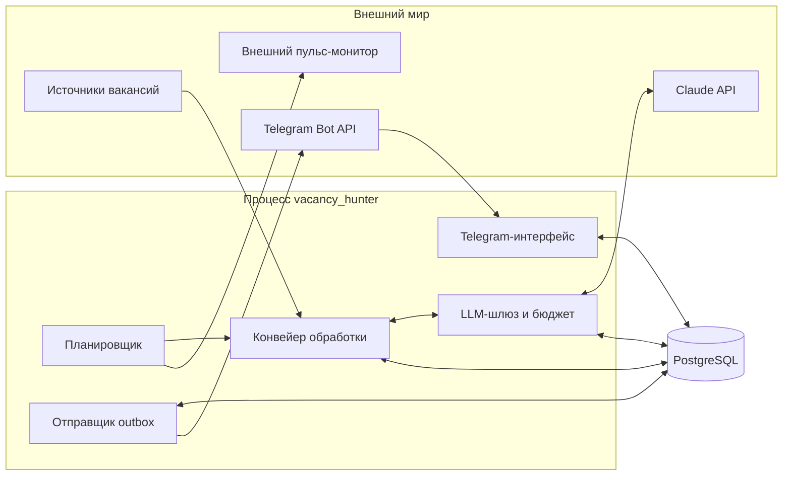
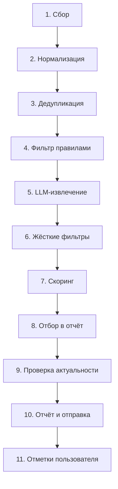

# ARCHITECTURE.md — AI Vacancy Hunter

Версия 1.7 от 12.11.2026. Статус: готов к реализации. Внешние проверки вынесены в шаги плана реализации (раздел 20).
Связанные документы: TECHNICAL_SPEC.md, DATABASE_SCHEMA.md, SOURCES.md, AGENT_PROMPTS.md, IMPLEMENTATION_PLAN.md, TEST_PLAN.md.

Этот документ фиксирует устройство системы. Он не содержит кода. Названия модулей, таблиц и статусов, введённые здесь, обязательны для остальных документов.

---

## 1. Назначение и границы

AI Vacancy Hunter — личная система одного пользователя. Она ежедневно собирает IT-вакансии, отбирает подходящие под профиль и присылает отчёт в Telegram в 07:00 по времени Грузии (Asia/Tbilisi, UTC+4).

Система делает:

- сбор предложений трёх типов — работа, стажировка, разовый проект или фриланс — из нескольких источников, нормализацию и дедупликацию. Далее в документах слово «вакансия» обозначает предложение любого из трёх типов;
- отсев по обязательным условиям и оценку соответствия от 0 до 100 с объяснением;
- проверку актуальности перед показом;
- ежедневный отчёт, ручной поиск, историю, отметки пользователя;
- подготовку сопроводительных писем по запросу.

Система не делает:

- не отправляет отклики работодателям;
- не обходит авторизацию, капчи и другие ограничения источников;
- не даёт LLM инструментов и права выполнять действия;
- не обслуживает нескольких пользователей (но данные профиля отделены от данных вакансий).

## 2. Принципы

| № | Принцип | Следствие |
|---|---------|-----------|
| P1 | LLM читает, код решает | LLM извлекает факты из текста вакансии. Фильтрацию, сопоставление с профилем и баллы считает Python |
| P2 | LLM не видит профиль при извлечении | Она не может приписать пользователю навык или опыт |
| P3 | Качество важнее количества | Отчёт не добивается до 10–15 позиций. Пустой отчёт допустим |
| P4 | Неизвестное не равно отказу | Неуказанное условие помечается и снижает балл, но не исключает вакансию |
| P5 | Внешний текст — данные | Никакая фраза из вакансии не меняет поведение системы |
| P6 | Каждый этап идемпотентен | Повторный запуск этапа не создаёт дублей и не тратит деньги повторно |
| P7 | Сбор отделён от отчёта | Сбой источника в момент отчёта не лишает пользователя уже собранного |
| P8 | Простота | Один процесс, одна база. Новые компоненты добавляются только под доказанную потребность |

## 3. Общая схема



Состав развёртывания: два постоянно работающих контейнера (приложение `app` и PostgreSQL `db`) и одноразовый сервис миграций `migrate` в Docker Compose. Сервис `migrate` запускается перед приложением, применяет миграции и завершается. Приложение — один asyncio-процесс, в котором работают планировщик, конвейер, бот (long polling) и отправщик сообщений.

## 4. Конвейер обработки



| Этап | Вход | Выход | Исполнитель |
|------|------|-------|-------------|
| 1. Сбор | Запросы из конфигурации, курсор источника | Сырые записи в `raw_items` | Адаптер источника |
| 2. Нормализация | Сырая запись | Вакансия в едином формате | Адаптер источника |
| 3. Дедупликация | Вакансия | Новая вакансия либо ссылка на существующую | Python + SQL |
| 4. Фильтр правилами | Заголовок, структурные поля, текст | Решение «дальше» или «отклонено» с кодом причины | Python |
| 5. LLM-извлечение | Текст вакансии | Факты с цитатами и уверенностью в `extractions` | LLM-шлюз, Haiku 5.5 |
| 6. Жёсткие фильтры | Факты, ограничения профиля | Статус каждого фильтра: да, нет, неизвестно | Python |
| 7. Скоринг | Факты, профиль, веса | Баллы по критериям, итог, объяснение в `scores` | Python |
| 8. Отбор | Оценённые непоказанные вакансии | Список отчёта, не более 15 | SQL |
| 9. Проверка актуальности | Отобранные вакансии | Признак «открыта» или «закрыта» | Адаптер источника |
| 10. Отчёт | Список | Сообщения в `outbox` | Python |
| 11. Отметки | Нажатия кнопок | Записи в `feedback_events` | Бот |

### 4.1. Статусы вакансии

Поле `vacancies.status` — единственный источник правды о том, где находится вакансия.

| Статус | Значение | Следующий шаг |
|--------|----------|---------------|
| `new` | Нормализована, ещё не проверена | Дедупликация и фильтр правилами |
| `awaiting_description` | Источник не дал описания, оценка по заголовку отложена (раздел 9.5). Состояние обработки, не оценка | Получение описания, затем `pending_llm` |
| `duplicate` | Копия другой вакансии | Конец. Хранится ссылка на оригинал |
| `rejected_rules` | Отклонена правилами до LLM | Конец. Хранится код причины |
| `pending_llm` | Ждёт извлечения | LLM-извлечение, когда позволяет бюджет |
| `llm_failed` | Три неудачные попытки извлечения | Ручной повтор командой либо очистка по сроку |
| `extracted` | Факты извлечены | Фильтры и скоринг |
| `rejected_gate` | Не прошла жёсткий фильтр | Конец. Доступна для ручного пересмотра |
| `scored` | Оценена, ждёт отчёта | Отбор в отчёт |
| `reported` | Показана пользователю | Отметки, письмо |
| `closed` | Источник сообщил о закрытии | Конец |

Вакансия со статусом `scored`, не попавшая в отчёт из-за лимита карточек, остаётся кандидатом на следующие дни, пока выполняется правило первого показа: она ни разу не показывалась в основном блоке, с её первой полной оценки прошло не более 3 дней, с публикации — не более 14 дней. Дата первой полной оценки и отметка о показе фиксируются один раз. Пересчёт, повторное получение описания и ручной пересмотр их не меняют, поэтому старые вакансии в ежедневный отчёт не возвращаются. Подробности — в TECHNICAL_SPEC.md, раздел 14.

## 5. Что чем решается

| Задача | Инструмент | Почему |
|--------|-----------|--------|
| Сбор, пагинация, курсоры | Python | Детерминированная работа с HTTP |
| Приведение полей к единому виду | Python | Формат источника известен |
| Дедупликация | SQL + нечёткое сравнение строк | Достаточно ключей и схожести названий |
| Отсев явно несовместимых профессий, офиса, устаревших публикаций, не вакансий | Правила | Дёшево и предсказуемо. Только при однозначном признаке. Слова уровня в названии и отсутствие технологий профиля основанием не являются |
| Понимание текста вакансии | LLM | Требования написаны свободным языком |
| Сопоставление навыков с профилем | Python | Словарь навыков и синонимов. LLM профиль не видит |
| Жёсткие фильтры и баллы | Python | Воспроизводимость, пересчёт без затрат |
| Объяснение оценки | Шаблоны Python | Строится из тех же чисел, что и балл |
| Проверка актуальности | Python | Запрос к источнику |
| Сопроводительное письмо | LLM | Генерация текста |
| Отбор и ранжирование | SQL | Сортировка по баллу и дате |

Отдельных автономных агентов в системе нет.

## 6. Источники данных

Каждый источник подключается адаптером с единым интерфейсом. Конвейер не знает, с каким источником работает.

| Операция адаптера | Назначение | Обязательна |
|-------------------|-----------|-------------|
| Получить новые записи | По запросам и курсору вернуть сырые записи и новый курсор | Да |
| Получить подробности | Дозагрузить полное описание, если список его не содержит | Нет |
| Нормализовать | Превратить сырую запись в вакансию единого формата | Да |
| Проверить актуальность | Сообщить, открыта ли вакансия | Нет |
| Описать себя | Код, тип доступа, лимиты частоты, домены | Да |

Правила:

- адаптеры регистрируются в реестре и включаются конфигурацией. Новый источник — новый файл адаптера и запись в конфигурации, без правок конвейера;
- состояние источника (курсор, время последнего успеха, число сбоев подряд) хранится в `source_state`, каждая попытка сбора — в `fetch_runs`;
- сбор идёт каждые 3 часа. Курсор сдвигается только после успешного сохранения записей. После сбоя следующий запуск забирает пропущенный интервал, поэтому вакансии не теряются;
- после 5 сбоев подряд источник помечается как деградировавший, интервал опроса растёт, пользователь получает одно оповещение. Сбой одного источника не останавливает остальные;
- разрешены только официальные API, RSS и публичные страницы без обхода защит.

Согласованные решения по доступу: hh.ru и hh.kz до получения токена приложения читаются через RSS поиска; Telegram-каналы читаются через публичные страницы t.me/s; Telethon отложен. Конкретный перечень адаптеров и их параметры фиксируются в SOURCES.md после аудита сборщиков соседнего проекта на том же сервере (раздел 20).

## 7. LLM-шлюз

Весь доступ к LLM идёт через один модуль. Прямые вызовы API из других модулей запрещены.

| Роль | Модель | Когда вызывается | Вход | Выход |
|------|--------|------------------|------|-------|
| Извлечение | Claude Haiku 5.5 | Для каждой вакансии в `pending_llm` | Текст вакансии, словарь навыков, схема | Структура фактов |
| Письмо и ответ работодателю | Claude Haiku 5.5 | По кнопке пользователя | Вакансия, факты, профиль | Текст письма или ответа |

Функции шлюза:

- выбор модели по роли из конфигурации (`llm.yaml`): идентификатор модели, версия промпта и цены задаются там. На старте все роли используют одну модель — Claude Haiku 5.5 (`claude-haiku-5-5`). Claude Sonnet 5.5 может быть включён только ручной правкой `llm.yaml` владельцем. Автоматического переключения на другую модель нет ни при каких условиях, включая ошибки и длинные тексты;
- ограничение длины одного запроса и ответа. Длинное описание не обрезается молча: оно обрабатывается частями до 6000 знаков, не более 4 частей, результаты объединяет код. Исходный текст хранится полностью. Если текст длиннее предела, это явно фиксируется пометкой «проанализировано N из M знаков» (AGENT_PROMPTS.md, раздел 5.4);
- проверка ответа по схеме. Невалидный ответ — одна повторная попытка, затем `llm_failed`;
- кэш: результат извлечения привязан к хешу текста, версии промпта и модели. Одинаковый текст повторно не оплачивается;
- ограничение параллельности (не более 4 одновременных запросов);
- учёт расходов и соблюдение бюджета (раздел 8).

Особенность Haiku 5.5: параметры temperature, top_p и top_k не передаются; глубина рассуждений задаётся параметром effort. Точные параметры вызова фиксируются в AGENT_PROMPTS.md и сверяются с документацией при реализации.

### 7.1. Уверенность в фактах

Каждый извлечённый факт сопровождается дословной цитатой из вакансии и уровнем уверенности: высокий, средний, низкий. Код проверяет, что цитата действительно есть в тексте.

| Ситуация | Действие |
|----------|----------|
| Цитата найдена, уверенность высокая или средняя | Факт используется |
| Цитата не найдена в тексте | Факт считается неизвестным, ставится флаг |
| Уверенность низкая | Факт для жёстких фильтров считается неизвестным |
| Факт не указан в вакансии | Значение «неизвестно» |

Отклонить вакансию по жёсткому фильтру можно только на основании подтверждённого цитатой факта.

## 8. Учёт расходов и бюджет

Требование: расходы на LLM не превышают $3 в месяц ни при каких условиях, включая параллельные запросы, повторные попытки, сбои и обработку длинных описаний. Целевой ориентир при обычном объёме — $0,50–2 в месяц; это ориентир, а не гарантия, фактический расход определяется по журналу вызовов. Все лимиты задаются в `llm.yaml`.

Верхняя граница стоимости вызова считается с запасом: один входной токен на каждый знак запроса плюс максимально разрешённый ответ. Входные токены при этом считаются по самой высокой цене входа — цене записи в кэш. Поэтому фактическая стоимость не может превысить резерв. Каждая часть длинного текста и каждая повторная попытка резервируются отдельно.

Механизм — резервирование до вызова:

1. В таблице `llm_budget` на каждый календарный месяц одна строка: лимит, израсходовано, зарезервировано.
2. Перед каждым вызовом шлюз считает верхнюю границу стоимости: число входных токенов по оценке сверху плюс максимально разрешённый выход, по ценам из конфигурации.
3. В одной транзакции с блокировкой строки месяца шлюз проверяет: израсходовано + зарезервировано + новая граница ≤ лимит. Если да, увеличивает резерв и создаёт запись в `llm_ledger` со статусом «зарезервировано». Если нет, вызов не выполняется.
4. После ответа резерв заменяется фактической стоимостью из отчёта API о токенах.
5. Если процесс упал между шагами 3 и 4, при старте незакрытый резерв списывается в расход по верхней границе: неизвестно, был ли запрос оплачен, поэтому считаем, что был.

Блокировка строки делает проверку и резервирование атомарными: два параллельных запроса не могут оба пройти на последние центы.

| Параметр | Значение |
|----------|----------|
| Месячный жёсткий лимит | $3,00. После достижения новые платные вызовы не выполняются |
| Суточный лимит на извлечение | $0,08. Не даёт потратить месяц за несколько дней |
| Резерв под письма и ответы | $0,30 из месячного лимита недоступны для извлечения |
| Лимит на проверку каналов в тихом сборе | $0,50 в месяц |
| Предупреждения пользователю | При расходе $1,50 и $2,50 |
| Поведение при исчерпании | Платные вызовы прекращаются. Вакансии остаются в `pending_llm`. Отчёт выходит с пометкой |
| Повторные попытки | Каждая резервируется отдельно. Не более 3 на вакансию |

Цены за токен хранятся в конфигурации с датой проверки. Дополнительная внешняя страховка: лимит расходов в консоли поставщика API, если он доступен на аккаунте.

## 9. Фильтры и скоринг

### 9.1. Жёсткие фильтры

Каждый фильтр возвращает одно из трёх состояний.

| Фильтр | «Нет» (исключить) | «Неизвестно» (пометить) |
|--------|-------------------|--------------------------|
| Формат | Офис, гибрид, обязательный переезд | Формат не указан |
| География | Явное требование находиться в стране или городе | Удалёнка без уточнения географии |
| Язык | Обязательно разговорное, свободное или письменное владение языком, которого нет в профиле | Язык упомянут без уровня или обязательности. Чтение технической документации требованием не считается |
| Документы | Обязательны документы или телефон, которых нет в профиле | Способ оформления не указан |
| Уровень | Подтверждённое обязательное требование от 5 лет опыта, независимо от названия должности | Стаж упомянут, но неясно, обязателен ли он |
| Характер работы | Основная часть — продажи, холодные звонки, переговоры | Доля не ясна |
| Достоверность | Не вакансия, платное «трудоустройство», сомнительные условия | Признаки неочевидны |
| Актуальность | Источник сообщил о закрытии | Проверка невозможна |

Любое «нет» даёт статус `rejected_gate`. «Неизвестно» не исключает вакансию: она идёт в скоринг с пометкой в карточке.

### 9.2. Балльная оценка

| Критерий | Максимум | На чём основан |
|----------|----------|----------------|
| Технический стек | 30 | Покрытие обязательных и желательных навыков вакансии навыками профиля |
| Опыт и задачи | 25 | Совпадение типов задач вакансии с проектами профиля |
| Уровень и стаж | 20 | Один штраф за стаж: обязательные 1–3 года, 3–5 лет либо подтверждённый старший или руководящий уровень без указанного стажа. Плюс подтверждённо невыполнимые прочие требования |
| Направление | 15 | Основное направление 15, смежное 8, прочее 0. Состав категорий — в TECHNICAL_SPEC.md, раздел 11.4 |
| Ясность условий | 10 | Насколько явно подтверждены удалёнка, география, оформление |

Поправки за свежесть объявления и приоритет географии суммарно не превышают ±5 баллов и показываются отдельной строкой. Зарплата в оценке не участвует и только показывается в карточке. Каждый недостаток учитывается в одном критерии, итог ограничен диапазоном 0–100. Формулы и значения — в TECHNICAL_SPEC.md, раздел 11.

Категории: 85–100 — отличное соответствие; 70–84 — хорошее; 50–69 — можно рассмотреть; ниже 50 — в основной отчёт не попадает.

### 9.3. Объяснение и пересчёт

- Объяснение строится шаблонами из тех же данных, что и балл: баллы по критериям, совпавшие и недостающие навыки, невыполненные требования, список неизвестных условий.
- Каждая оценка хранит версию правил и версию профиля. При изменении профиля или весов оценки пересчитываются без обращения к LLM.
- История оценок не перезаписывается: пересчёт создаёт новую оценку, прежняя остаётся в истории. Состояния оценки: актуальная, ожидает пересчёта, ошибка пересчёта, устаревшая. Подробности — в DATABASE_SCHEMA.md, раздел 6.2.

### 9.4. Ручной пересмотр

Пользователь может изменить решение системы по любой вакансии, включая отклонённые фильтром: вернуть в подборку, задать свой балл, пометить фильтр как ошибочный. Правка хранится в `score_overrides` отдельно от расчёта и имеет приоритет над ним. Автоматический пересчёт её не затирает. Правки используются для калибровки правил.

### 9.5. Предварительная оценка по заголовку

Для источников, которые не отдают полное описание (сейчас это hh через RSS), применяется ограниченный режим. Подробные правила — в SOURCES.md, раздел 5.1.

- LLM не вызывается, вакансия получает статус `scored` с видом оценки «предварительная».
- Вид оценки хранится в `scores` отдельным полем. Предварительные и обычные оценки не сортируются вместе и не складываются в статистике.
- Предварительный балл не превышает 69.
- Вакансия без описания со словом уровня в названии (Senior, Lead и подобные) не оценивается и не показывается: она получает статус `awaiting_description` и ждёт полного описания.
- После появления полного описания вакансия проходит обычный путь: `pending_llm` → `extracted` → `scored` с обычной оценкой. Описание записывается в существующую строку, дубль не создаётся.
- Вакансия, уже показанная по заголовку, после полной оценки в ежедневный отчёт не возвращается. Владелец получает одно уведомление «Дооценено N вакансий, из них M получили 70 и более баллов» с кнопкой показа списка.

## 10. Отчёт и Telegram-интерфейс

Отбор в ежедневный отчёт: вакансии в статусе `scored` с баллом не ниже порога показа, не показанные ранее, по убыванию балла, не более заданного числа карточек, не более 3 от одной компании. Порог (по умолчанию 50, диапазон 50–90), число карточек (по умолчанию 15, диапазон 1–15) и время отчёта меняются через /settings. Архитектурный максимум 15 карточек не увеличивается. Если подходящих меньше, отчёт короче. Если их нет, приходит сводка без карточек.

Вакансии с предварительной оценкой (раздел 9.5) идут отдельным блоком «Только по заголовку» после основных карточек: не более 5 в день, с обязательной пометкой, что полное описание не проверено. В лимит 15 они не входят.

Каждая карточка начинается с типа предложения: «Работа», «Стажировка» или «Разовый проект / фриланс». Типы показываются в общем блоке с общим лимитом карточек и общей сортировкой по баллу, статистика ведётся раздельно по типам. В /today, /stats и результатах поиска есть фильтр по типу. Отдельных конвейеров и лимитов для типов нет.

Состав отчёта: сводка (сколько найдено, новых, отклонено, недоступные источники, остаток бюджета) и по одному сообщению на вакансию с кнопками.

| Команда | Действие |
|---------|----------|
| /start | Описание системы |
| /today | Сегодняшний отчёт повторно |
| /search | Ручной поиск по запросу |
| /settings | Настройки поиска и порогов |
| /feedback | Отзыв о качестве подбора |
| /stats | Статистика вакансий и откликов |
| /status | Состояние источников, задач и бюджета |

Кнопки карточки: интересно, откликнулся, отклонить (с выбором причины), письмо, подробнее, пересмотреть оценку.

Доступ: бот отвечает только пользователю с идентификатором из конфигурации. Остальные обращения игнорируются и журналируются.

Все исходящие сообщения проходят через `outbox` (раздел 12).

## 11. Планировщик

APScheduler 3.x в том же процессе. Расписание задаётся в коде и конфигурации; постоянное хранилище заданий не используется, состояние задач лежит в `job_runs`.

| Задача | Расписание (Asia/Tbilisi) | Назначение |
|--------|---------------------------|-----------|
| Сбор | Каждые 3 часа | Этапы 1–4 по всем включённым источникам |
| Обработка | Каждые 30 минут | Этапы 5–7 для накопившихся вакансий |
| Отчёт | 07:00 по умолчанию, меняется через /settings | Этапы 8–10 |
| Отправка | Каждые 10 секунд | Доставка сообщений из `outbox` |
| Очистка | 03:30 | Раздел 13 |
| Резервная копия | 04:00 | Раздел 15 |
| Пульс | Каждые 15 минут | Сигнал внешнему монитору |

Каждая задача берёт блокировку в базе, поэтому два экземпляра одной задачи одновременно не работают.

## 12. Восстановление после перезапуска

Цель: после любого падения работа продолжается с места остановки, данные не теряются, уведомления не дублируются.

| Что могло прерваться | Как восстанавливается |
|----------------------|------------------------|
| Сбор из источника | Курсор не сдвинут. Следующий запуск повторяет интервал. Уже сохранённые записи отсекаются уникальным ключом |
| Обработка вакансии | Статус не изменён. Вакансия берётся повторно. Этап идемпотентен |
| LLM-вызов | Резерв бюджета списывается по верхней границе. Вакансия остаётся в `pending_llm`. Готовый результат в кэше повторно не оплачивается |
| Формирование отчёта | Отчёт на дату уникален. Повторный запуск продолжает существующий, а не создаёт новый |
| Отправка сообщения | Правила `outbox` ниже |
| Пропущенное расписание | При старте: если отчёта за сегодня нет и время между 07:00 и 14:00, он запускается сразу. Сбор и обработка запускаются сразу всегда |

Захват работы: задача помечает взятые записи временем аренды. Аренда, не продлённая 15 минут, считается брошенной и освобождается при старте и по расписанию.

Правила `outbox`:

1. Сообщение создаётся в той же транзакции, что и бизнес-событие, с уникальным ключом (например, дата отчёта и идентификатор вакансии). Повторное создание невозможно.
2. Состояния: ожидает → отправляется → отправлено либо ошибка.
3. Перед вызовом Telegram запись переводится в «отправляется». После подтверждения — в «отправлено».
4. Если процесс упал в состоянии «отправляется», исход неизвестен. Такое сообщение автоматически повторно не отправляется: оно помечается «не подтверждено».
5. Неподтверждённые карточки видны по команде /today, а в сводке следующего запуска указывается их число. Данные не теряются, дубль не возникает.
6. Ошибки с явным отказом Telegram (лимит частоты, сеть до отправки) повторяются с нарастающей паузой, до 5 попыток.

## 13. Хранение и очистка данных

Сроки задаются в конфигурации. Значения по умолчанию:

| Данные | Срок хранения | Что происходит после |
|--------|---------------|----------------------|
| Сырые записи `raw_items` | 30 дней | Удаляются |
| Вакансии с отметкой пользователя (интересно, откликнулся) | Бессрочно | — |
| Показанные вакансии без отметки | 180 дней | Текст описания удаляется, остаётся карточка и ключи |
| Отклонённые и непоказанные вакансии | 60 дней | Текст удаляется, остаются ключи дедупликации |
| Ключи дедупликации | 365 дней | Удаляются. До этого повторная публикация не показывается как новая |
| Результаты извлечения `extractions` | Пока хранится текст вакансии | Удаляются вместе с текстом |
| Оценки, правки, отметки, письма | Вместе с вакансией | — |
| Журнал расходов `llm_ledger` | 13 месяцев | Сворачивается в помесячные итоги |
| `fetch_runs`, `job_runs` | 90 дней | Удаляются |
| `outbox` | 30 дней после отправки | Удаляются |
| Логи приложения | Ротация: 5 файлов по 10 МБ | Старые перезаписываются |
| Резервные копии | 7 ежедневных и 4 еженедельных | Старые удаляются |

Очистка выполняется небольшими порциями и записывает в `job_runs`, сколько строк удалено.

## 14. Модель данных (обзор)

| Группа | Таблицы | Содержимое |
|--------|---------|-----------|
| Источники | `source_state`, `fetch_runs`, `raw_items`, `source_checks` | Состояние, история запусков, сырые записи, история проверок качества |
| Профиль и правила | `profile_versions`, `scoring_versions` | Неизменяемые снимки профиля и правил скоринга |
| Вакансии | `vacancies`, `vacancy_sources` | Единая карточка и связи с источниками |
| Анализ | `extractions`, `scores`, `score_overrides` | Факты LLM, расчёт, ручные правки |
| Отчёты | `reports`, `report_items`, `outbox` | Отчёты, их состав, исходящие сообщения |
| Пользователь | `feedback_events`, `cover_letters` | Отметки, причины отказа, письма |
| Расходы | `llm_budget`, `llm_ledger` | Месячный бюджет, журнал вызовов |
| Служебные | `job_runs`, `app_state` | Запуски задач, настройки времени выполнения |

Профиль пользователя, словарь навыков, веса и поисковые запросы редактируются в файлах конфигурации под контролем версий. При изменении профиля или правил приложение сохраняет в базу неизменяемый снимок с номером версии. Каждая оценка ссылается на версию профиля и версию правил, по которым она посчитана. Всего в базе 20 таблиц. Поля, связи и индексы описывает DATABASE_SCHEMA.md.

## 15. Развёртывание и эксплуатация

| Вопрос | Решение |
|--------|---------|
| Упаковка | Docker Compose: контейнер приложения, контейнер PostgreSQL и одноразовый сервис миграций `migrate` на образе приложения. Образы для amd64 и arm64 |
| Роли базы | Три роли. Администратор — только при первом запуске базы (скрипт `docker/db-init/`): создание баз, ролей, расширения `pg_trgm`. Пользователь миграций — владелец схемы проекта, права только на неё, используется только сервисом `migrate`. Пользователь приложения — только SELECT, INSERT, UPDATE, DELETE, без создания и удаления таблиц. В окружение `app` попадают только данные пользователя приложения |
| Автозапуск | Политика перезапуска контейнеров и включённая служба Docker |
| Конфигурация | Несекретные настройки в YAML-файлах репозитория. Секреты в `.env` на сервере, в репозитории только `.env.example` |
| Миграции базы | Alembic. Применяются отдельным одноразовым сервисом `migrate` под пользователем миграций. Контейнер `app` запускается только после успешного завершения `migrate` |
| Обновление | Получить код из Git, пересобрать образ, запустить `migrate`, затем перезапустить контейнер приложения (команда `docker compose up -d --build` делает это по порядку). База при этом не перезапускается |
| Резервные копии | Ежедневный дамп базы. Копия хранится на сервере и отправляется пользователю файлом в Telegram |
| Проверка восстановления | Раз в месяц дамп разворачивается в пустую базу по инструкции |
| Режим бота | Long polling. Открытые порты не нужны. Порт базы наружу не публикуется |

### 15.1. Проверка существующего Oracle-сервера

Решение о размещении принимается после проверки. Что проверить:

| Проверка | Требование |
|----------|-----------|
| ОС и архитектура | Зафиксировать версию и тип процессора. Убедиться, что Docker Engine и Compose устанавливаются |
| Свободная память | Не менее 1 ГБ сверх занятого работающими ботами |
| Свободный диск | Не менее 10 ГБ |
| Работающие службы | Список служб systemd и занятых портов. Конфликтов быть не должно |
| Сетевой доступ | С сервера открываются все включённые источники, Claude API и Telegram |
| Изоляция | Отдельный каталог проекта и отдельная сеть Docker. Существующие боты не затрагиваются |

Если проверка не пройдена, система ставится на отдельный недорогой VPS с Ubuntu без изменений в архитектуре.

## 16. Надёжность и наблюдаемость

| Механизм | Параметры |
|----------|-----------|
| Таймауты HTTP | Соединение 10 с, ответ 30 с |
| Повторы HTTP | До 3 раз с нарастающей паузой, только для сетевых ошибок и кодов 429 и 5xx |
| Ограничение частоты | Отдельная пауза между запросами для каждого домена |
| Логи | Структурированные записи в стандартный вывод контейнера с ротацией |
| Журнал операций | `fetch_runs`, `job_runs`, `llm_ledger` — основа для /status и /stats |
| Внешний пульс | Сервис-сторож ждёт сигнал каждые 15 минут и оповещает, если сигнала нет |
| Оповещения | Ошибки задач приходят в Telegram, не чаще одного сообщения на тип ошибки в час |

## 17. Безопасность

| Угроза | Защита |
|--------|--------|
| Утечка ключей | Секреты только в `.env` с правами владельца. В логи и сообщения не попадают |
| Чужой доступ к боту | Список разрешённых идентификаторов. Прочие обращения игнорируются |
| Доступ к базе | Порт не опубликован. Отдельный пользователь базы с правами только на свою схему |
| Prompt injection | Текст вакансии передаётся как данные в отмеченном блоке. У LLM нет инструментов. Ответ проверяется по схеме. Цитаты сверяются с текстом |
| Вредные ссылки | Ссылка в карточке берётся только из записи источника, никогда из ответа LLM |
| Разметка в тексте | Весь внешний и сгенерированный текст экранируется перед отправкой |
| Ловушки для ИИ в вакансиях | Фразы, обращённые к ИИ, и особые требования к отклику извлекаются отдельным полем и показываются пользователю. Письмо их не исполняет автоматически |
| Запросы на посторонние адреса | Запросы идут только на домены, объявленные адаптерами |
| Потеря данных | Резервные копии и проверка восстановления |

Худший исход успешной инъекции — неверные факты по одной вакансии. Действий система по тексту вакансии не выполняет.

## 18. Структура проекта

```
vacancy-hunter/
├── docs/                    восемь документов проекта
├── config/                  profile, skills, scoring, sources, retention, schedule, llm
├── migrations/              миграции Alembic
├── src/
│   ├── hunter_core/         общая техническая основа, без логики вакансий
│   │   ├── config           загрузка настроек и секретов
│   │   ├── http             клиент, таймауты, повторы, лимиты частоты
│   │   ├── sources          интерфейс адаптера, реестр, запуск сбора
│   │   ├── llm              шлюз, поставщики, бюджет, кэш
│   │   ├── scheduler        обёртка планировщика, блокировки, аренды
│   │   ├── notify           outbox и отправщик Telegram
│   │   ├── storage          подключение к базе, общие таблицы
│   │   └── observability    логи, пульс, оповещения
│   └── vacancy_hunter/      предметная логика
│       ├── sources          адаптеры конкретных источников
│       ├── pipeline         этапы конвейера
│       ├── matching         профиль, словарь навыков, фильтры, скоринг
│       ├── reporting        отбор и карточки
│       ├── letters          сопроводительные письма
│       ├── prompts          тексты промптов P1–P3
│       ├── bot              команды и кнопки
│       └── storage          таблицы вакансий
├── tests/
├── docker-compose.yml
└── .env.example
```

Правило зависимостей: `vacancy_hunter` импортирует `hunter_core`, обратное запрещено и проверяется тестом.

### 18.1. Повторное использование в AI Business Hunter

AI Business Hunter — будущий отдельный продукт со своей базой, настройками, расписанием и логикой. Общая платформа сейчас не строится. Единственное, что закладывается заранее, — граница между двумя пакетами.

| Вопрос | Решение |
|--------|---------|
| Что проектируется как переиспользуемое | Весь `hunter_core`: HTTP-клиент с повторами и паузами, интерфейс адаптера источника и реестр, запуск сбора и контроль состояния источников, LLM-шлюз с бюджетом и кэшем, обёртка планировщика с блокировками, `outbox` и отправщик Telegram, допуск по идентификатору владельца, загрузка конфигурации, логирование, пульс, тестовые подставные компоненты |
| Что остаётся независимым | Всё в `vacancy_hunter`: сущности и таблицы вакансий, адаптеры конкретных источников, дедупликация, правила, промпты и схема фактов, фильтры, скоринг, профиль, отчёты, команды бота, расписание, файлы конфигурации |
| Общие таблицы | `source_state`, `fetch_runs`, `raw_items`, `llm_budget`, `llm_ledger`, `outbox`, `job_runs`, `app_state` не содержат понятий вакансий. У каждого продукта своя база и свои миграции, в которые эти таблицы включаются |
| Как не смешать логику | Тест направления импортов; в `hunter_core` нет слов «вакансия», «профиль», «скоринг» |
| Как избежать преждевременной платформы | Интерфейсы `hunter_core` не обобщаются заранее под второй продукт. Обобщение выполняется, когда второй продукт начат и видно, что ему действительно нужно |
| Что переиспользуется как идея, а не как код | Форма конвейера: сбор, нормализация, дедупликация, правила, извлечение фактов с цитатами, оценка кодом, отчёт, отметки |
| Как развивать два продукта | Этап D плана реализации: один репозиторий с общим пакетом и отдельными приложениями. Изменение `hunter_core` проверяется тестами обоих приложений |

## 19. Журнал согласованных решений

| № | Решение | Отклонённая альтернатива | Причина |
|---|---------|---------------------------|---------|
| D1 | hh через токен приложения, до него RSS | Разбор HTML-страниц | Только разрешённые способы |
| D2 | LLM извлекает, Python оценивает | Балл от LLM | Воспроизводимость, защита от завышения |
| D3 | PostgreSQL, Docker Compose, APScheduler 3.x | SQLite; APScheduler 4 | Требование владельца; ветка 4 не стабильна |
| D4 | Без FastAPI, Redis, очередей, микросервисов | Отдельные сервисы | Нет задач, которые их требуют |
| D5 | Размещение на Oracle-сервере после проверки | Сразу новый VPS | Нулевые затраты при совместимости |
| D6 | Telegram-каналы через t.me/s | Telethon | Нет риска для аккаунта. Telethon на следующем этапе |
| D7 | Заменено решением D22 | — | — |
| D8 | Резервирование бюджета до вызова | Подсчёт после вызова | Гарантия при параллельных запросах |
| D9 | Сообщение с неизвестным исходом не повторяется | Повтор до успеха | Дубли хуже, чем показ по /today |
| D10 | Неизвестное условие не исключает вакансию | Строгий отсев | Большинство вакансий не указывают географию |
| D11 | Отчёт не добивается до 10–15 | Снижение порога | Качество важнее количества |
| D12 | Ручная правка оценки приоритетнее расчёта | Только автоматическая оценка | Контроль остаётся у пользователя |
| D13 | hh до получения токена — предварительная оценка по заголовку отдельным блоком, не выше 69, до 5 в день | Не показывать hh вовсе; смешать с обычным скорингом | Не терять крупнейший источник и не выдавать грубую оценку за полную |
| D14 | Из соседнего проекта переносятся список каналов и принципы; его код, база, токен, сессия и служба не затрагиваются | Общий сборщик на Telethon | Работающий продукт не должен зависеть от нового |
| D15 | Новые каналы проходят 14 дней тихого сбора; активные пересматриваются раз в 30 дней и при падении качества уходят на повторную проверку | Включать сразу; удалять навсегда | Качество отчёта и обратимость решения |
| D16 | Профиль редактируется в файле, в базе хранятся неизменяемые версии; оценки не перезаписываются | Профиль только в файле; обновление оценки на месте | История и воспроизводимость каждой оценки |
| D17 | Уровень: исключение только при обязательном стаже от 5 лет; слово уровня в названии даёт штраф, а не исключение | Отсев Senior/Lead по названию | Название не отражает фактические обязанности |
| D18 | Статус `awaiting_description` для вакансий без описания, отложенных до получения доступа | Использовать статус `new` с кодом причины | Один статус — один смысл |
| D19 | Окно первого показа: 3 дня от первой полной оценки и 14 дней от публикации; даты фиксируются один раз | Отсчёт от первого обнаружения | Вакансия не теряется при задержке анализа и не возвращается в отчёт после пересчёта |
| D20 | Вакансии hh, показанные по заголовку, после дооценки не возвращаются в отчёт; одно уведомление со списком | Повторный показ при 70+ | Одна вакансия — один показ в ежедневном отчёте |
| D21 | Разовые проекты и фриланс входят в поиск наравне с работой и стажировками; тип указан в карточке, статистика раздельная | Только постоянная работа и стажировки; отдельный конвейер для проектов | Те же навыки и те же источники. Один конвейер проще двух |
| D22 | Одна модель на старте — Claude Haiku 5.5 для извлечения, писем и ответов; жёсткий лимит $3 в месяц, предупреждения при $1,50 и $2,50; все лимиты в конфигурации | Sonnet 5.5 для писем и лимит $10 | Экономия. Другая модель включается только вручную |
| D23 | Длинные описания обрабатываются частями, исходный текст хранится полностью | Обрезка до предела | Без молчаливой потери требований из конца текста |
| D24 | Общий лимит 15 карточек и общая сортировка для трёх типов предложений; фильтр по типу в интерфейсе | Отдельные блоки и лимиты по типам | Простота. Отдельные конвейеры не создаются |
| D25 | Содержание документа об общих компонентах включено в раздел 18.1; отдельный файл не создаётся | SHARED_COMPONENTS.md | Нет дублирования |
| D26 | Скрапинг и сбор данных — основное направление; обязательный письменный английский исключает вакансию наравне с разговорным | Скрапинг как смежное; исключение только за разговорный | Окончательные решения владельца от 12.11.2026 |
| D27 | Этап 0 не блокирует разработку: каждая внешняя проверка выполняется перед шагом, которому нужна; замер объёмов перенесён в начало эксплуатации | Отдельный этап проверок до начала работ | Недоступная внешняя зависимость отключается, ядро разрабатывается |
| D28 | Структурированные ответы через `output_config.format`; схемы без необязательных полей; ограничения длины и диапазонов проверяет код | Инструмент-схема | Проверено по документации API 12.11.2026 |

## 20. Открытые вопросы

| № | Вопрос | Кто закрывает | Что блокирует |
|---|--------|---------------|---------------|
| Q1 | Закрыт 12.11.2026: аудит получен, перечень источников зафиксирован в SOURCES.md | — | — |
| Q2 | Одобрит ли hh заявку на приложение | Владелец подаёт заявку | Полные описания вакансий hh |
| Q3 | Проверка сервера по разделу 15.1 | Шаг 0.3, перед развёртыванием в A8 | Не блокирует разработку A1–A7 |
| Q4 | Доступность каждого источника | Шаг A3 (команда проверки источников), повтор с сервера на шаге 0.3 | Не блокирует: недоступный источник отключается |
| Q5 | Закрыт частично: профиль берётся из резюме. Не уточнены документы, телефоны и способ оформления; до уточнения фильтр «Документы» только ставит пометку «требует проверки» с причиной | Владелец | Исключение по фильтру «Документы» |
| Q6 | Закрыт 12.11.2026: контакт в Telegram подтверждён резюме | — | — |
| Q7 | Сервис внешнего пульса и доступность лимита расходов в консоли API | Шаги A2 и A5 | Не блокирует: пульс отключается в конфигурации |
| Q8 | Фактический объём токенов на вакансию | Первая неделя работы | Суточный лимит, прогноз расходов |
