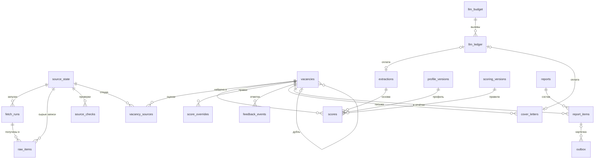

# DATABASE_SCHEMA.md — структура базы данных AI Vacancy Hunter

Версия 1.5 от 12.11.2026. Статус: готов к реализации.
Опирается на ARCHITECTURE.md версии 1.7 и SOURCES.md версии 1.6. Названия таблиц, полей и значений, введённые здесь, обязательны для остальных документов.

Документ описывает структуру словами и таблицами. Команд создания таблиц и другого кода в нём нет: миграции пишутся при реализации по этому описанию.

---

## 1. Соглашения

| Тема | Правило |
|------|---------|
| СУБД | PostgreSQL 16 или новее, одна база, одна схема |
| Имена | Строчные латинские буквы и подчёркивания. Таблицы во множественном числе, кроме `source_state` и `app_state` |
| Первичный ключ | Поле `id`, целое 64-битное, генерируется базой. Исключения указаны явно |
| Время | Тип «дата и время с часовым поясом», всегда UTC. Перевод в Asia/Tbilisi выполняет приложение |
| Перечисления | Текстовое поле с ограничением допустимых значений. Значения перечислены в описании поля |
| Деньги | Точное десятичное число, 6 знаков после запятой, доллары США |
| JSON | Тип JSONB. Используется только для данных, структура которых задаётся приложением и не участвует в связях: факты извлечения, разбивка баллов, снимки конфигурации |
| Внешние ключи | Объявляются всегда. Поведение при удалении указано в описании поля |
| Неизменяемые таблицы | `profile_versions`, `scoring_versions`, `feedback_events`, `source_checks`: строки только добавляются |
| Удаление | Только задачей очистки (раздел 12). Пользовательские действия ничего не удаляют |

Обозначения в таблицах полей: **PK** — первичный ключ, **FK** — внешний ключ, **UQ** — уникальность, **NN** — значение обязательно.

## 2. Схема связей

Таблицы `job_runs` и `app_state` связей не имеют. Всего 20 таблиц.

## 3. Источники и сбор

### 3.1. `source_state` — состояние источника

Одна строка на источник. Каждый Telegram-канал — отдельный источник. Адрес, запросы и паузы источника лежат в конфигурации, здесь только изменяемое состояние. Строка создаётся при первом запуске с новым источником и не удаляется.

| Поле | Тип | Описание |
|------|-----|----------|
| `code` | текст, PK | Код источника: `tg_it_interns`, `hh_rss_ru`, `habr_career` |
| `kind` | текст, NN | `telegram`, `rss`, `api` |
| `mode` | текст, NN | `active` — в отчёте; `quiet` — тихий сбор; `waiting` — ждёт внешнего события; `disabled` — отключён |
| `mode_reason` | текст | Причина текущего режима: `initial_check`, `recheck`, `owner`, `blocked`, `failed_check` |
| `health` | текст, NN | `ok`, `degraded`, `blocked` |
| `cursor` | JSONB | Позиция сбора: номер последнего поста или отметка времени |
| `last_run_at`, `last_success_at` | время | Последний запуск и последний успех |
| `consecutive_failures` | целое, NN | Сбоев подряд. Сбрасывается при успехе |
| `last_error` | текст | Краткий текст последней ошибки |
| `check_started_at` | время | Начало текущего периода наблюдения |
| `check_extensions` | целое, NN | Сколько раз наблюдение продлено (0–2) |
| `failed_rechecks` | целое, NN | Непройденных повторных проверок подряд |
| `posts_total` | целое, NN | Публикаций за текущий период |
| `vacancies_real` | целое, NN | Из них реальных IT-вакансий |
| `passed_profile` | целое, NN | Из них прошли фильтры профиля |
| `llm_sampled` | целое, NN | Сколько постов периода прошло через LLM (не более 30 в тихом режиме) |
| `relevance_pct` | число | `vacancies_real` к `posts_total`, в процентах |
| `last_check_at` | время | Дата последней завершённой проверки |
| `created_at`, `updated_at` | время, NN | Служебные |

Счётчики периода обнуляются при завершении проверки. Перед обнулением итог записывается в `source_checks`.

### 3.2. `fetch_runs` — запуски сборщиков

Одна строка на каждую попытку сбора из одного источника.

| Поле | Тип | Описание |
|------|-----|----------|
| `id` | PK | |
| `source_code` | текст, FK → `source_state`, NN | |
| `started_at`, `finished_at` | время | `finished_at` пусто, пока запуск идёт |
| `status` | текст, NN | `running`, `success`, `partial`, `failed`, `abandoned` |
| `items_seen`, `items_new` | целое | Получено записей и из них новых |
| `cursor_before`, `cursor_after` | JSONB | Курсор до и после. При сбое `cursor_after` пуст |
| `http_requests` | целое | Число запросов |
| `error_code`, `error_text` | текст | Причина сбоя |

Запуск со статусом `running` старше 15 минут при старте приложения получает статус `abandoned`. Курсор источника при этом не сдвинут, следующий запуск повторяет интервал.

### 3.3. `raw_items` — сырые записи

Исходный ответ источника до нормализации. Нужен для отладки адаптеров и повторной нормализации.

| Поле | Тип | Описание |
|------|-----|----------|
| `id` | PK | |
| `source_code` | текст, FK → `source_state`, NN | |
| `external_id` | текст, NN | Идентификатор записи в источнике |
| `fetch_run_id` | FK → `fetch_runs` | При удалении запуска обнуляется |
| `url` | текст | Прямая ссылка |
| `payload` | JSONB, NN | Запись в исходном виде |
| `published_at` | время | Дата публикации по данным источника |
| `fetched_at` | время, NN | |

Уникальность: (`source_code`, `external_id`). Повторное получение той же записи не создаёт строку.

### 3.4. `source_checks` — история проверок источников

Одна строка на каждую завершённую проверку качества. Только добавление.

| Поле | Тип | Описание |
|------|-----|----------|
| `id` | PK | |
| `source_code` | текст, FK → `source_state`, NN | |
| `kind` | текст, NN | `initial` — первый тихий сбор; `recheck` — повторная проверка; `monthly` — пересмотр активного |
| `period_start`, `period_end` | время, NN | |
| `posts_total`, `vacancies_real`, `passed_profile`, `llm_sampled` | целое, NN | Итоги периода |
| `relevance_pct` | число | |
| `llm_cost_usd` | деньги | Расход на проверку |
| `result` | текст, NN | `included`, `kept`, `extended`, `sent_to_recheck`, `rejected` |
| `decided_by` | текст, NN | `auto`, `owner` |
| `note` | текст | Комментарий владельца |
| `created_at` | время, NN | |

## 4. Вакансии

### 4.1. `vacancies` — единая карточка вакансии

| Поле | Тип | Описание |
|------|-----|----------|
| `id` | PK | |
| `status` | текст, NN | `new`, `awaiting_description`, `duplicate`, `rejected_rules`, `pending_llm`, `llm_failed`, `extracted`, `rejected_gate`, `scored`, `reported`, `closed` (ARCHITECTURE.md, 4.1) |
| `status_reason` | текст | Код причины для `rejected_rules`, `rejected_gate`, `llm_failed`. Для `awaiting_description` — причина последней неудачной попытки получить описание |
| `description_requested_at` | время | Последняя попытка получить описание |
| `title` | текст, NN | Название должности |
| `company_name` | текст | Как в источнике |
| `company_norm` | текст | Нормализованное название: без формы собственности, кавычек, регистра |
| `title_norm` | текст | Нормализованное название должности |
| `description_text` | текст | Полный текст. Пусто, если источник не дал описания или текст очищен |
| `description_hash` | текст | SHA-256 нормализованного текста. Сохраняется после очистки текста |
| `has_description` | логическое, NN | Ложь для ограниченного режима hh |
| `canonical_url` | текст | Ссылка на вакансию в приведённом виде |
| `salary_from`, `salary_to` | целое | |
| `salary_currency`, `salary_period` | текст | |
| `location_raw` | текст | Как в источнике |
| `country_code` | текст | Двухбуквенный код, если определён |
| `work_format_src`, `experience_src` | текст | Структурные поля источника, если есть |
| `offer_type` | текст, NN | Тип предложения: `job` — работа; `internship` — стажировка; `project` — разовый проект или фриланс; `unknown` — не определён. Заполняется по структурному полю источника или по фактам извлечения |
| `published_at` | время | Дата публикации |
| `first_seen_at`, `last_seen_at` | время, NN | |
| `primary_source_code` | текст, FK → `source_state` | Источник, из которого взята ссылка для карточки |
| `duplicate_of` | FK → `vacancies` | Оригинал, если это дубль |
| `quiet_only` | логическое, NN | Истина, пока вакансия известна только из источников в тихом режиме. Такие в отчёт не попадают |
| `user_state` | текст, NN | `none`, `interested`, `applied`, `rejected`. Производное от `feedback_events` |
| `user_state_at` | время | |
| `first_full_scored_at` | время | Момент первой успешной полной оценки. Записывается один раз и не изменяется пересчётом, повторным извлечением, получением описания и ручным пересмотром |
| `reported_at` | время | Первый показ в основном блоке отчёта. Записывается один раз и не изменяется |
| `title_only_reported_at` | время | Показ в блоке «Только по заголовку» |
| `alive_checked_at` | время | Последняя проверка актуальности |
| `closed_at` | время | |
| `llm_attempts` | целое, NN | Попыток извлечения (не более 3) |
| `lease_until` | время | Аренда на обработку (раздел 13) |
| `text_purged_at` | время | Когда удалён текст описания |
| `created_at`, `updated_at` | время, NN | |

Ключи дедупликации — поля `canonical_url`, `description_hash` и пара (`company_norm`, `title_norm`). Они остаются после очистки текста на срок из раздела 12.

### 4.2. `vacancy_sources` — где вакансия найдена

Связь вакансии со всеми источниками, включая дубли из разных мест.

| Поле | Тип | Описание |
|------|-----|----------|
| `id` | PK | |
| `vacancy_id` | FK → `vacancies`, NN | Удаляется вместе с вакансией |
| `source_code` | текст, FK → `source_state`, NN | |
| `external_id` | текст, NN | |
| `url` | текст | Ссылка в этом источнике |
| `raw_item_id` | FK → `raw_items` | Обнуляется при очистке сырых записей |
| `first_seen_at` | время, NN | |

Уникальность: (`source_code`, `external_id`). Это вторая линия защиты от повторной обработки: она действует и после удаления строки из `raw_items`.

## 5. Профиль и правила

Профиль и правила редактируются в файлах конфигурации. При старте и по команде приложение считает хеш содержимого. Если хеш новый, в базу добавляется неизменяемый снимок и он становится текущим. Таблицы только пополняются.

### 5.1. `profile_versions` — версии профиля

| Поле | Тип | Описание |
|------|-----|----------|
| `id` | PK | |
| `version_no` | целое, UQ, NN | Порядковый номер |
| `content_hash` | текст, UQ, NN | Хеш содержимого файлов профиля и словаря навыков |
| `profile` | JSONB, NN | Снимок профиля: позиционирование, навыки, проекты, направления, языки, ограничения, неизвестные параметры |
| `skills_dictionary` | JSONB, NN | Снимок словаря навыков: канонические названия, синонимы, смежные навыки |
| `source_note` | текст | Основание версии, например «резюме от 01.01.2026» |
| `is_current` | логическое, NN | Истина ровно у одной строки |
| `created_at` | время, NN | |

Параметры, которые пока не определены (документы, телефон, способ оформления), хранятся в снимке со значением «неизвестно». Фильтр по ним даёт только пометку «требует проверки».

### 5.2. `scoring_versions` — версии правил скоринга

| Поле | Тип | Описание |
|------|-----|----------|
| `id` | PK | |
| `version_no` | целое, UQ, NN | |
| `content_hash` | текст, UQ, NN | Хеш файла правил |
| `rules` | JSONB, NN | Снимок: веса критериев, пороги категорий, правила жёстких фильтров, поправки, правила отсева до LLM |
| `is_current` | логическое, NN | Истина ровно у одной строки |
| `created_at` | время, NN | |

## 6. Анализ и оценки

### 6.1. `extractions` — факты, извлечённые LLM, и кэш

Одна строка на уникальное сочетание текста, модели и версии промпта. Таблица одновременно хранит результат и служит кэшем.

| Поле | Тип | Описание |
|------|-----|----------|
| `id` | PK | |
| `text_hash` | текст, NN | Равен `vacancies.description_hash` |
| `model` | текст, NN | Идентификатор модели |
| `prompt_version` | текст, NN | Версия промпта и схемы ответа |
| `status` | текст, NN | `ok` — готово; `partial` — обработаны не все части длинного текста; `invalid` — ответ не прошёл проверку |
| `parts_total`, `parts_done` | целое, NN | Число частей текста и число обработанных. Для короткого текста 1 и 1 |
| `parts` | JSONB | Результаты отдельных частей до объединения. Нужны для продолжения после перезапуска |
| `chars_total`, `chars_analyzed` | целое, NN | Длина исходного текста и длина проанализированной части. Различаются только при превышении предела частей |
| `facts` | JSONB | Структура фактов. У каждого факта значение, цитата и уверенность: `high`, `medium`, `low` |
| `quote_check` | JSONB | Итог сверки цитат с текстом: сколько подтверждено, какие факты понижены до «неизвестно» |
| `flags` | JSONB | Признаки: текст обращён к ИИ, особые требования к отклику, не вакансия |
| `ledger_id` | FK → `llm_ledger` | Запись об оплате. Обнуляется при очистке журнала |
| `created_at` | время, NN | |

Уникальность: (`text_hash`, `model`, `prompt_version`).

Правила кэша:

- перед вызовом LLM ищется строка с текущими `model` и `prompt_version` из конфигурации и статусом `ok`. Если она есть, вызов не выполняется;
- при смене промпта или модели совпадения нет, создаётся новая строка. Старые строки остаются в истории и для новых оценок не используются;
- две вакансии с одинаковым текстом используют одну строку;
- строка со статусом `invalid` кэшем не считается;
- строка со статусом `partial` кэшем не считается, но её обработанные части повторно не вызываются: извлечение продолжается с первой необработанной части.

### 6.2. `scores` — оценки

Одна строка на каждый расчёт. Строки не изменяются по существу и не удаляются до очистки вакансии: при новом расчёте добавляется новая строка.

| Поле | Тип | Описание |
|------|-----|----------|
| `id` | PK | |
| `vacancy_id` | FK → `vacancies`, NN | Удаляется вместе с вакансией |
| `kind` | текст, NN | `full` — по полному описанию; `preliminary` — только по заголовку |
| `state` | текст, NN | `current`, `pending_recalc`, `recalc_failed`, `outdated` |
| `extraction_id` | FK → `extractions` | Пусто для `preliminary`. Обнуляется при очистке извлечения |
| `profile_version_id` | FK → `profile_versions`, NN | |
| `scoring_version_id` | FK → `scoring_versions`, NN | |
| `gate_result` | текст, NN | `passed`, `rejected` |
| `gates` | JSONB, NN | По каждому фильтру: состояние «да», «нет», «неизвестно», причина, цитата |
| `unknowns` | JSONB | Список условий «требует проверки» с причиной |
| `breakdown` | JSONB | Баллы по пяти критериям и поправки |
| `total` | целое | 0–100. Для `preliminary` не выше 69 |
| `category` | текст | `excellent`, `good`, `consider`, `hidden`. Для `preliminary` только `consider` или `hidden` |
| `explanation` | JSONB | Данные для объяснения: совпавшие и недостающие навыки, невыполненные требования, задачи и проекты |
| `error_text` | текст | Причина для `recalc_failed` |
| `superseded_by` | FK → `scores` | Какая строка заменила эту |
| `created_at`, `superseded_at` | время | |

Состояния оценки:

| Состояние | Значение | Используется в отчёте |
|-----------|----------|-----------------------|
| `current` | Актуальная, посчитана по текущим версиям или пересчёт не требовался | Да |
| `pending_recalc` | Версия профиля или правил изменилась, пересчёт ещё не выполнен | Да, с пометкой |
| `recalc_failed` | Пересчёт не удался, действует прежний расчёт | Да, с пометкой |
| `outdated` | Заменена новой строкой. Только история | Нет |

Переходы:

1. Появилась новая версия профиля или правил. Оценки в состоянии `current` у вакансий, подлежащих пересчёту, переводятся в `pending_recalc`.
2. Задача пересчёта берёт факты из `extractions` и создаёт новую строку `current`. Старая получает `outdated`, `superseded_by` и `superseded_at`.
3. При ошибке старая строка получает `recalc_failed` и остаётся действующей. Повтор — при следующем запуске задачи.

Пересчёту подлежат все вакансии в статусах `scored`, `rejected_gate` и `reported`, у которых сохранён текст и извлечение, без ограничения по возрасту. LLM при пересчёте не вызывается. Статус вакансии `scored` и `rejected_gate` может измениться по итогам пересчёта, `reported` не меняется.

Правила выполнения пересчёта:

| Правило | Содержание |
|---------|-----------|
| Пакеты | Задача `recalc` обрабатывает оценки пакетами по 200 строк, каждый пакет в отдельной транзакции |
| Порядок | От свежих вакансий к старым, по `first_seen_at` |
| Прогресс | Отдельного счётчика нет: необработанные строки остаются в состоянии `pending_recalc`. После перезапуска задача продолжает с них |
| Независимость | Пересчёт не берёт блокировок задач `report` и `collect` и не мешает боту. Отчёт использует оценку в состоянии `pending_recalc` с пометкой |
| Свежесть | Пересчёт не меняет `first_seen_at`, `published_at`, `first_full_scored_at` и `reported_at`. Старая вакансия не попадает в отчёт на основании пересчёта: условия возраста и однократного показа из раздела 14 действуют без изменений |
| История | Прежняя оценка получает `outdated` и остаётся в таблице |

Ограничение уникальности: у одной вакансии не более одной действующей строки (состояния `current`, `pending_recalc`, `recalc_failed`) каждого вида. Предварительные и полные оценки хранятся в одной таблице, но не пересекаются: у них разные значения `kind`, раздельные ограничения уникальности и раздельные индексы отбора.

### 6.3. `score_overrides` — ручные правки

| Поле | Тип | Описание |
|------|-----|----------|
| `id` | PK | |
| `vacancy_id` | FK → `vacancies`, NN | Удаляется вместе с вакансией |
| `kind` | текст, NN | `set_total` — свой балл; `force_include` — вернуть в подборку; `force_exclude` — убрать; `gate_wrong` — фильтр ошибся |
| `gate_code` | текст | Для `gate_wrong` |
| `new_total` | целое | Для `set_total` |
| `comment` | текст | |
| `based_on_score_id` | FK → `scores` | Какую оценку правили |
| `is_active` | логическое, NN | Отменённая правка остаётся в истории |
| `created_at`, `revoked_at` | время | |

Действует последняя активная правка каждого вида. Пересчёт оценок правки не трогает.

## 7. Отчёты и уведомления

### 7.1. `reports`

| Поле | Тип | Описание |
|------|-----|----------|
| `id` | PK | |
| `kind` | текст, NN | `daily`, `search` |
| `report_date` | дата, NN | Дата по Asia/Tbilisi |
| `search_query` | текст | Для `search` |
| `status` | текст, NN | `building`, `ready`, `sent`, `partial` |
| `stats` | JSONB | Сводка: найдено, новых, отклонено, недоступные источники, остаток бюджета, число неподтверждённых сообщений. Количественные показатели хранятся с разбивкой по `offer_type` |
| `created_at`, `completed_at` | время | |

Уникальность: один отчёт вида `daily` на дату. Повторный запуск задачи продолжает существующий отчёт.

### 7.2. `report_items` — состав отчёта

| Поле | Тип | Описание |
|------|-----|----------|
| `id` | PK | |
| `report_id` | FK → `reports`, NN | Удаляется вместе с отчётом |
| `vacancy_id` | FK → `vacancies`, NN | |
| `block` | текст, NN | `main`, `title_only` |
| `position` | целое, NN | Порядок внутри блока |
| `score_id` | FK → `scores` | Оценка, показанная пользователю |
| `total_snapshot` | целое | Балл на момент показа |

Уникальность: (`report_id`, `vacancy_id`). Команда /today читает эту таблицу, а не `outbox`, поэтому показывает весь состав отчёта независимо от исхода отправки.

### 7.3. `outbox` — исходящие сообщения

| Поле | Тип | Описание |
|------|-----|----------|
| `id` | PK | |
| `dedup_key` | текст, UQ, NN | Смысловой ключ сообщения |
| `chat_id` | целое, NN | |
| `kind` | текст, NN | `report_header`, `vacancy_card`, `alert`, `letter`, `backup`, `system` |
| `report_item_id` | FK → `report_items` | Для карточек |
| `payload` | JSONB, NN | Готовый текст, кнопки, параметры отправки |
| `state` | текст, NN | `pending`, `sending`, `sent`, `failed`, `unconfirmed` |
| `attempts` | целое, NN | Не более 5 |
| `next_attempt_at` | время | Когда повторять |
| `sending_started_at` | время | Момент перехода в `sending` |
| `telegram_message_id` | целое | Заполняется после подтверждения |
| `error_text` | текст | |
| `created_at`, `sent_at` | время | |

Защита от дублей:

- сообщение создаётся в одной транзакции с событием, которое его породило;
- `dedup_key` строится из смысла сообщения: для карточки это идентификатор отчёта и вакансии, для сводки — идентификатор отчёта, для оповещения — тип ошибки и час;
- повторная попытка создать сообщение с тем же ключом отклоняется базой.

Неопределённый результат отправки:

| Ситуация | Состояние | Дальнейшее действие |
|----------|-----------|---------------------|
| Ошибка до отправки или явный отказ Telegram | `pending` с новым `next_attempt_at` | Повтор, до 5 попыток, затем `failed` |
| Telegram подтвердил приём | `sent` | — |
| Процесс остановился в состоянии `sending` | `unconfirmed` при старте | Автоматически не повторяется |

Сообщение `unconfirmed` не теряется: карточка доступна по /today, число таких сообщений попадает в сводку. Повторная выдача по /today создаёт новые строки с ключом, включающим идентификатор запроса пользователя: это явное действие, а не дубль.

## 8. Отметки пользователя

### 8.1. `feedback_events` — журнал отметок

Только добавление. Ни одна отметка не изменяется и не затирается следующей.

| Поле | Тип | Описание |
|------|-----|----------|
| `id` | PK | |
| `vacancy_id` | FK → `vacancies` | Удаляется вместе с вакансией. Пусто только для события `note` без привязки к вакансии (общий отзыв из /feedback) |
| `event` | текст, NN | `interested`, `applied`, `rejected`, `cleared`, `note` |
| `reason_code` | текст | Причина отказа: `stack`, `level`, `not_remote`, `company`, `sales`, `conditions`, `seen`, `other` |
| `comment` | текст | |
| `score_id` | FK → `scores` | Оценка, которую пользователь видел в этот момент |
| `created_at` | время, NN | |

Поле `vacancies.user_state` хранит текущее состояние и обновляется в той же транзакции. Его всегда можно восстановить из журнала. История откликов — это события `applied` вместе с письмами из `cover_letters`.

### 8.2. `cover_letters` — письма и ответы работодателю

| Поле | Тип | Описание |
|------|-----|----------|
| `id` | PK | |
| `vacancy_id` | FK → `vacancies`, NN | Удаляется вместе с вакансией |
| `kind` | текст, NN | `letter`, `answer` |
| `question` | текст | Вопрос работодателя для `answer` |
| `version_no` | целое, NN | Номер варианта для этой вакансии |
| `text` | текст, NN | |
| `model`, `prompt_version` | текст, NN | |
| `profile_version_id` | FK → `profile_versions`, NN | |
| `ledger_id` | FK → `llm_ledger` | Обнуляется при очистке журнала |
| `created_at` | время, NN | |

## 9. Расходы LLM

### 9.1. `llm_budget` — месячный бюджет

Одна строка на календарный месяц. Строка — точка блокировки для всех денежных операций.

| Поле | Тип | Описание |
|------|-----|----------|
| `month` | дата, PK | Первое число месяца |
| `limit_usd` | деньги, NN | Месячный жёсткий лимит. По умолчанию 3,00, берётся из `llm.yaml` при создании строки месяца |
| `spent_usd` | деньги, NN | Фактически израсходовано |
| `reserved_usd` | деньги, NN | Зарезервировано под вызовы в работе |
| `letters_reserve_usd` | деньги, NN | Часть лимита, недоступная извлечению (0,30) |
| `daily_extraction_limit_usd` | деньги, NN | Суточный лимит на извлечение (0,08) |
| `quiet_limit_usd`, `quiet_spent_usd` | деньги, NN | Лимит и расход на проверку каналов (0,50) |
| `warn1_usd`, `warn2_usd` | деньги, NN | Пороги предупреждений (1,50 и 2,50) |
| `warn1_sent`, `warn2_sent` | логическое, NN | Отправлено ли предупреждение по каждому порогу |
| `updated_at` | время, NN | |

Ограничение на уровне базы: `spent_usd` плюс `reserved_usd` не превышает `limit_usd`. Запись, нарушающая это условие, отклоняется базой независимо от логики приложения.

### 9.2. `llm_ledger` — журнал вызовов

Одна строка на каждый вызов LLM, включая повторные.

| Поле | Тип | Описание |
|------|-----|----------|
| `id` | PK | |
| `month` | дата, FK → `llm_budget`, NN | |
| `purpose` | текст, NN | `extraction`, `quiet_check`, `letter`, `answer` |
| `model` | текст, NN | |
| `vacancy_id` | FK → `vacancies` | Обнуляется при удалении вакансии |
| `attempt_no` | целое, NN | |
| `part_no` | целое | Номер части длинного текста. Пусто для писем |
| `state` | текст, NN | `reserved`, `settled`, `released`, `assumed_spent` |
| `reserved_usd` | деньги, NN | Верхняя граница стоимости |
| `actual_usd` | деньги | Фактическая стоимость |
| `tokens_in` | целое | Обычные входные токены (поле `input_tokens` ответа API) |
| `tokens_cache_write` | целое | Токены, записанные в кэш запроса (`cache_creation_input_tokens`) |
| `tokens_cache_read` | целое | Токены, прочитанные из кэша запроса (`cache_read_input_tokens`) |
| `tokens_out` | целое | Выходные токены, включая рассуждения (`output_tokens`) |
| `stop_reason` | текст | Причина завершения из ответа API: обычное завершение, обрезка по пределу, отказ модели |
| `started_at`, `finished_at` | время | |
| `error_text` | текст | |

Атомарное резервирование. Все шаги выполняются в одной транзакции:

1. Строка текущего месяца в `llm_budget` блокируется на изменение. Параллельные запросы ждут освобождения блокировки и видят уже обновлённые суммы.
2. Проверяются условия: общий лимит; для извлечения — остаток с учётом `letters_reserve_usd` и суточный лимит (сумма за сегодня по журналу); для проверки каналов — `quiet_limit_usd`.
3. Если хотя бы одно условие не выполнено, транзакция завершается без изменений, вызов не выполняется.
4. Иначе `reserved_usd` увеличивается, в журнал добавляется строка `reserved`.

Завершение вызова — вторая транзакция с той же блокировкой:

| Исход | Состояние строки | Изменение бюджета |
|-------|------------------|-------------------|
| Ответ получен | `settled` | Резерв снимается, `spent_usd` растёт на фактическую стоимость |
| Запрос не был отправлен | `released` | Резерв снимается, расход не меняется |
| Исход неизвестен (остановка процесса, обрыв после отправки) | `assumed_spent` | Резерв снимается, `spent_usd` растёт на верхнюю границу |

Строки `reserved` старше 15 минут переводятся в `assumed_spent` при старте и по расписанию. Суточный расход считается по журналу под той же блокировкой, отдельная таблица для него не нужна.

## 10. Служебные таблицы

### 10.1. `job_runs` — запуски задач планировщика

| Поле | Тип | Описание |
|------|-----|----------|
| `id` | PK | |
| `job_name` | текст, NN | `collect`, `process`, `report`, `recalc`, `source_review`, `cleanup`, `backup` |
| `status` | текст, NN | `running`, `success`, `failed`, `abandoned` |
| `started_at`, `finished_at` | время | |
| `lease_until` | время | Аренда. Продлевается, пока задача работает |
| `stats` | JSONB | Итоги: обработано, удалено, пропущено |
| `error_text` | текст | |

Ограничение уникальности: не более одной строки `running` на `job_name`. Это блокировка от параллельного запуска одной задачи.

### 10.2. `app_state` — настройки времени выполнения

| Поле | Тип | Описание |
|------|-----|----------|
| `key` | текст, PK | |
| `value` | JSONB, NN | |
| `updated_at` | время, NN | |

Содержимое: признак паузы, значения из /settings, отметка последней отправки пульса. Секреты здесь не хранятся.

## 11. Индексы и ограничения уникальности

| Таблица | Поля | Вид | Назначение |
|---------|------|-----|-----------|
| `raw_items` | (`source_code`, `external_id`) | Уникальный | Запись не сохраняется дважды |
| `raw_items` | `fetched_at` | Обычный | Очистка |
| `fetch_runs` | (`source_code`, `started_at`) | Обычный | История источника, /status |
| `source_checks` | (`source_code`, `created_at`) | Обычный | История проверок |
| `vacancy_sources` | (`source_code`, `external_id`) | Уникальный | Защита от повторной обработки |
| `vacancy_sources` | `vacancy_id` | Обычный | Источники вакансии |
| `vacancies` | `status` | Обычный | Очередь конвейера |
| `vacancies` | `canonical_url` | Обычный | Дедупликация по ссылке |
| `vacancies` | `description_hash` | Обычный | Дедупликация по тексту, связь с кэшем |
| `vacancies` | (`company_norm`, `title_norm`) | Обычный | Дедупликация по названию |
| `vacancies` | `title_norm` | Триграммный | Нечёткое сравнение названий |
| `vacancies` | `first_seen_at` | Обычный | Очистка, окна свежести |
| `vacancies` | (`offer_type`, `first_seen_at`) | Обычный | Раздельная статистика по типам предложения |
| `vacancies` | `user_state`, кроме `none` | Частичный | Списки «интересно» и «откликнулся» |
| `profile_versions`, `scoring_versions` | `is_current` = истина | Частичный уникальный | Ровно одна текущая версия |
| `extractions` | (`text_hash`, `model`, `prompt_version`) | Уникальный | Кэш |
| `scores` | (`vacancy_id`, `kind`), состояние не `outdated` | Частичный уникальный | Одна действующая оценка каждого вида |
| `scores` | (`kind`, `total`), состояние не `outdated` | Частичный | Отбор в отчёт, раздельно по видам |
| `scores` | `state` = `pending_recalc` | Частичный | Очередь пересчёта |
| `score_overrides` | `vacancy_id`, активные | Частичный | Действующие правки |
| `reports` | (`kind`, `report_date`), вид `daily` | Частичный уникальный | Один ежедневный отчёт на дату |
| `report_items` | (`report_id`, `vacancy_id`) | Уникальный | Вакансия входит в отчёт один раз |
| `outbox` | `dedup_key` | Уникальный | Защита от повторных уведомлений |
| `outbox` | (`state`, `next_attempt_at`) | Обычный | Очередь отправки |
| `feedback_events` | (`vacancy_id`, `created_at`) | Обычный | История отметок |
| `llm_ledger` | (`month`, `started_at`) | Обычный | Суточный расход, /status |
| `llm_ledger` | `state` = `reserved` | Частичный | Поиск незакрытых резервов |
| `job_runs` | `job_name`, статус `running` | Частичный уникальный | Одна работающая задача |

Триграммный индекс требует стандартного расширения PostgreSQL для сравнения строк. Других расширений схема не использует.

## 12. Сроки хранения и очистка

Сроки совпадают с ARCHITECTURE.md, раздел 13, и задаются в конфигурации. Задача `cleanup` выполняется ежедневно в 03:30, работает порциями до 1000 строк и записывает итог в `job_runs`.

| Шаг | Что делается | Условие |
|-----|--------------|---------|
| 1 | Удаление `raw_items` | Старше 30 дней |
| 2 | Очистка текста отклонённых и непоказанных вакансий: `description_text` обнуляется, ставится `text_purged_at` | Статусы `duplicate`, `rejected_rules`, `rejected_gate`, `llm_failed`, `closed` или `scored` без показа; старше 60 дней; `user_state` = `none` |
| 3 | Очистка текста показанных вакансий | `reported`, `user_state` = `none`, старше 180 дней |
| 4 | Удаление `extractions` | Ни одна вакансия с сохранённым текстом не ссылается на `text_hash` |
| 5 | Удаление вакансий целиком, вместе с `vacancy_sources`, `scores`, `score_overrides`, `feedback_events`, `cover_letters` | Текст очищен, `user_state` = `none`, старше 365 дней |
| 6 | Удаление отправленных сообщений `outbox` | Состояние `sent` или `failed`, старше 30 дней |
| 7 | Удаление `fetch_runs` и `job_runs` | Старше 90 дней |
| 8 | Удаление `report_items` и `reports` | Старше 365 дней |
| 9 | Удаление `llm_ledger` | Старше 13 месяцев. Помесячные итоги остаются в `llm_budget` |

Что не удаляется никогда:

- вакансии с `user_state`, отличным от `none`, со всеми их оценками, отметками и письмами;
- `profile_versions`, `scoring_versions`, `source_state`, `source_checks`, `llm_budget`;
- вакансии в статусе `awaiting_description`, пока их источник ожидает доступа к описаниям.

Между шагами 2–3 и шагом 5 вакансия хранится без текста, но с ключами дедупликации. В это время повторная публикация той же вакансии распознаётся как дубль. Пересчёт оценок для вакансий без текста не выполняется: их оценки остаются с теми версиями, по которым были посчитаны.

## 13. Восстановление после перезапуска

При старте приложение выполняет проверку состояния до запуска планировщика.

| Незавершённая операция | Как обнаруживается | Действие |
|------------------------|--------------------|----------|
| Запуск сборщика | `fetch_runs.status` = `running` старше 15 минут | Статус `abandoned`. Курсор не сдвинут, интервал будет собран заново |
| Задача планировщика | `job_runs.status` = `running`, `lease_until` в прошлом | Статус `abandoned`, блокировка снята |
| Обработка вакансии | `vacancies.lease_until` в прошлом | Аренда снимается. Статус не менялся, вакансия берётся повторно |
| Вызов LLM | `llm_ledger.state` = `reserved` старше 15 минут | `assumed_spent`, резерв переносится в расход |
| Извлечение длинного текста | `extractions.status` = `partial` | Продолжение с первой необработанной части. Обработанные части не оплачиваются повторно |
| Готовое извлечение без оценки | Вакансия в `pending_llm`, а в `extractions` есть строка с её хешем | Вакансия переходит в `extracted` без нового вызова |
| Пересчёт оценок | `scores.state` = `pending_recalc` | Задача `recalc` продолжает с оставшихся строк |
| Сборка отчёта | `reports.status` = `building` | Отчёт дособирается. Уже добавленные `report_items` защищены уникальностью |
| Отправка сообщения | `outbox.state` = `sending` | `unconfirmed`, автоматически не повторяется |
| Очередь отправки | `outbox.state` = `pending` | Отправка продолжается в обычном порядке |

Все изменения статуса вакансии и создание связанных строк (оценка, элемент отчёта, сообщение) выполняются в одной транзакции. Поэтому после остановки не бывает оценки без статуса или сообщения без элемента отчёта.

## 14. Типовые операции

| Операция | Что читается и по каким условиям |
|----------|----------------------------------|
| Очередь на извлечение | `vacancies` со статусом `pending_llm`, без действующей аренды, `llm_attempts` меньше 3, новые первыми |
| Отбор в основной блок отчёта | `vacancies` со статусом `scored`, `quiet_only` ложь, `reported_at` пусто, `first_full_scored_at` не старше 3 дней, `published_at` не старше 14 дней, `user_state` не `rejected`; действующая оценка вида `full` с `gate_result` = `passed`; балл не ниже порога показа из `app_state` (по умолчанию 50) либо активная правка `force_include`; без активной `force_exclude`; сортировка по баллу с учётом `set_total`; не более числа карточек из `app_state` (от 1 до 15, по умолчанию 15) и не более 3 на `company_norm` |
| Отбор в блок «Только по заголовку» | То же для оценок вида `preliminary`, `title_only_reported_at` пусто, не более 5 |
| /today | `report_items` отчёта `daily` за сегодня с вакансиями и показанными оценками. Отдельно — число сообщений `unconfirmed` |
| Списки «интересно» и «откликнулся» | `vacancies` по `user_state`, история из `feedback_events` |
| Пересчёт после смены профиля или правил | Оценки `current` у вакансий с сохранённым текстом переводятся в `pending_recalc`, затем обрабатываются задачей `recalc` |
| Остаток бюджета | `llm_budget` текущего месяца: лимит минус расход минус резерв |
| Статистика канала | Текущие счётчики из `source_state`, история из `source_checks` |
| Переход hh с заголовков на полный анализ | Вакансии со статусом `awaiting_description` и открытые вакансии с `has_description` ложь получают описание в ту же строку и статус `pending_llm`. Идентификатор берётся из `vacancy_sources`, новая вакансия не создаётся. Оценка `preliminary` получает `outdated` после появления оценки `full`. При неудаче статус не меняется, причина пишется в `status_reason` |
| Список дооценённых вакансий hh | `vacancies` с заполненным `title_only_reported_at` и действующей оценкой вида `full`, по убыванию балла. В ежедневный отчёт не входят |
| Очередь на получение описания | `vacancies` со статусом `awaiting_description`, у которых `description_requested_at` пусто или старше суток |

## 15. Миграции

| Правило | Содержание |
|---------|-----------|
| Инструмент | Alembic. Миграции применяются отдельным одноразовым сервисом `migrate` до запуска приложения. Приложение стартует только после успешного завершения `migrate` |
| Роли | Миграции выполняет пользователь миграций — владелец схемы проекта. Приложение работает под пользователем приложения с правами только SELECT, INSERT, UPDATE, DELETE на таблицы и использование последовательностей. Права на будущие таблицы выдаются пользователю приложения автоматически (права по умолчанию). Администратор используется только при первом запуске базы |
| Порядок создания | 1) `source_state`, `app_state`, `job_runs`, `llm_budget`, `profile_versions`, `scoring_versions`; 2) `fetch_runs`, `raw_items`, `source_checks`, `llm_ledger`, `vacancies`; 3) `vacancy_sources`, `extractions`, `scores`, `reports`; 4) `score_overrides`, `feedback_events`, `cover_letters`, `report_items`; 5) `outbox` |
| Изменения | Только новыми миграциями. Применённые миграции не редактируются |
| Совместимость | Перед миграцией, удаляющей поле или таблицу, делается резервная копия |
| Границы пакетов | Таблицы `source_state`, `fetch_runs`, `raw_items`, `llm_budget`, `llm_ledger`, `outbox`, `job_runs`, `app_state` не содержат понятий, специфичных для вакансий, кроме необязательной ссылки `vacancy_id` в `llm_ledger` и `report_item_id` в `outbox`. Это учитывается в ARCHITECTURE.md, раздел 18.1 |

## 16. Открытые вопросы

| № | Вопрос | Кто закрывает |
|---|--------|---------------|
| B1 | Точная структура JSON-полей `facts`, `gates`, `breakdown`, `explanation`, `profile` | TECHNICAL_SPEC.md и AGENT_PROMPTS.md |
| B2 | Значения лимитов бюджета после замера фактического объёма токенов | Первая неделя работы |
| B3 | Закрыт 12.11.2026: пересчитываются все вакансии с сохранённым текстом, пакетами, от свежих к старым | — |
